# ABA Consultorias: site institucional e portal de empreendimentos

Plataforma completa de uma consultoria de engenharia que aprova e executa loteamentos (projetos de água e esgoto,
regularização, projetos de casas). Ela substituiu um site WordPress por um único app **Next.js + Supabase** com quatro
públicos diferentes:

- **Visitantes:** site institucional com serviços, projetos entregues, loteamentos à venda e contato.
- **Clientes (loteadores):** portal com o andamento de cada projeto, os documentos aprovados, o financeiro e o
  cronograma de pagamentos.
- **Empreiteiros e fornecedores:** acompanham as obras, enviam relatos com fotos e consultam contratos e documentos.
- **Equipe interna:** painel administrativo com permissões granulares, gestão de conteúdo, empreendimentos, documentos,
  financeiro e um **conector** que sincroniza os PDFs do servidor de arquivos do escritório com o portal.

> Este repositório é uma **cópia de portfólio** do projeto em produção. O código é o mesmo. Ficaram de fora a
> documentação interna de planejamento, o histórico de commits e os dados reais de clientes. Os prints usam
> empreendimentos e contas de teste.

<p align="center">
  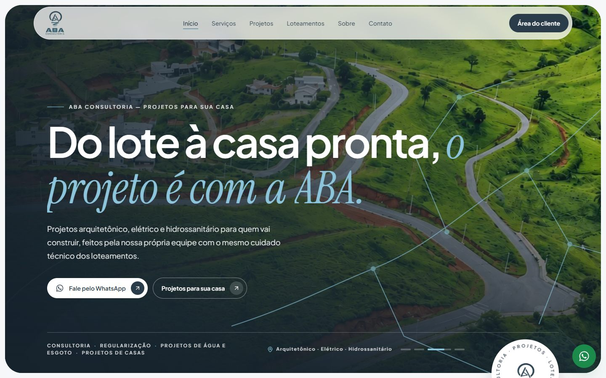
</p>

## Prints

| Site público | |
|---|---|
| 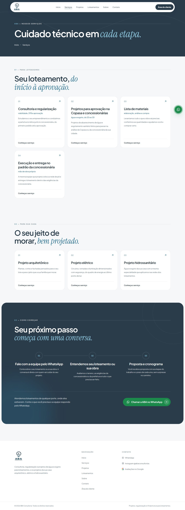 | 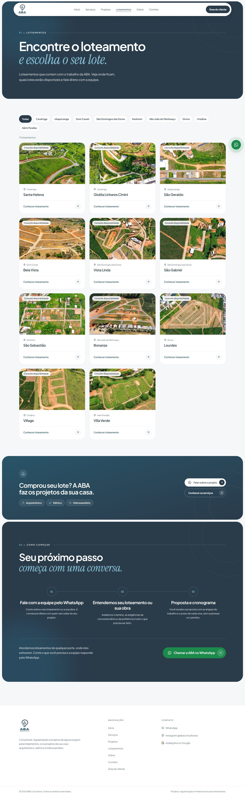 |
| 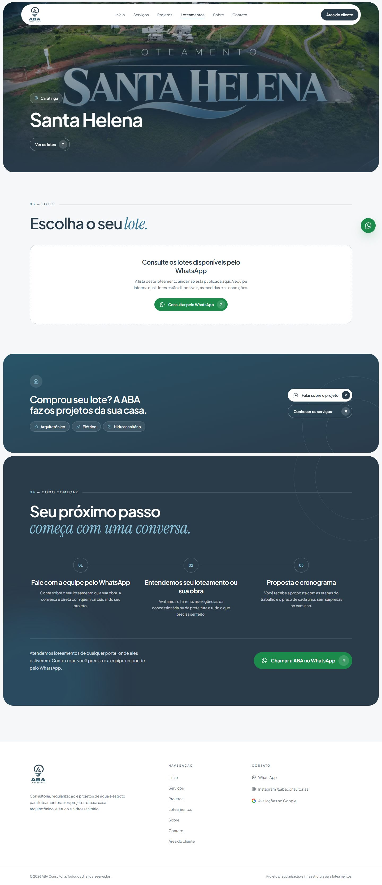 | 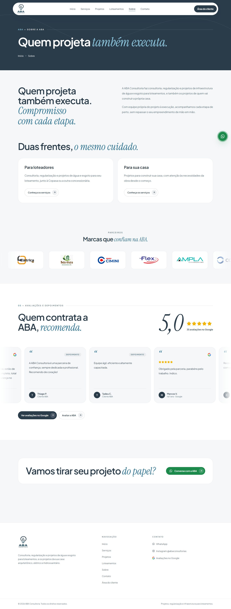 |

| Portal do cliente | |
|---|---|
| 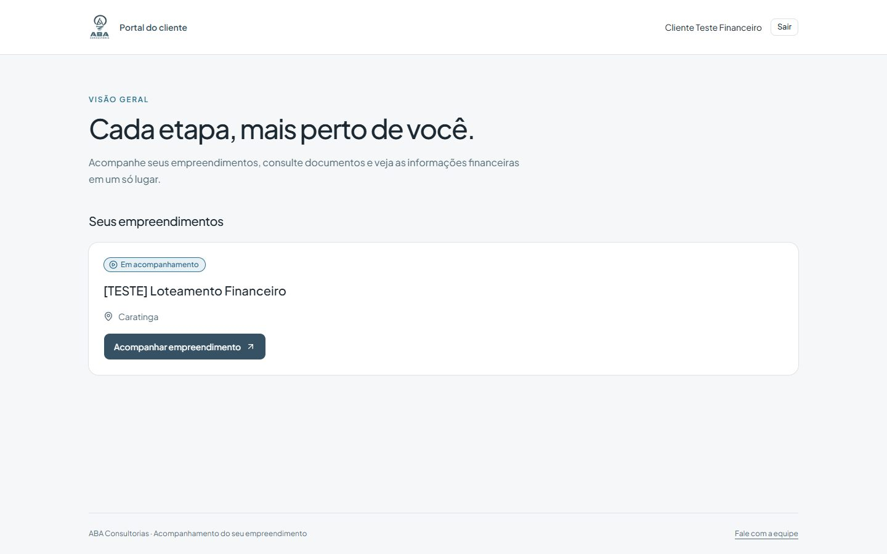 | 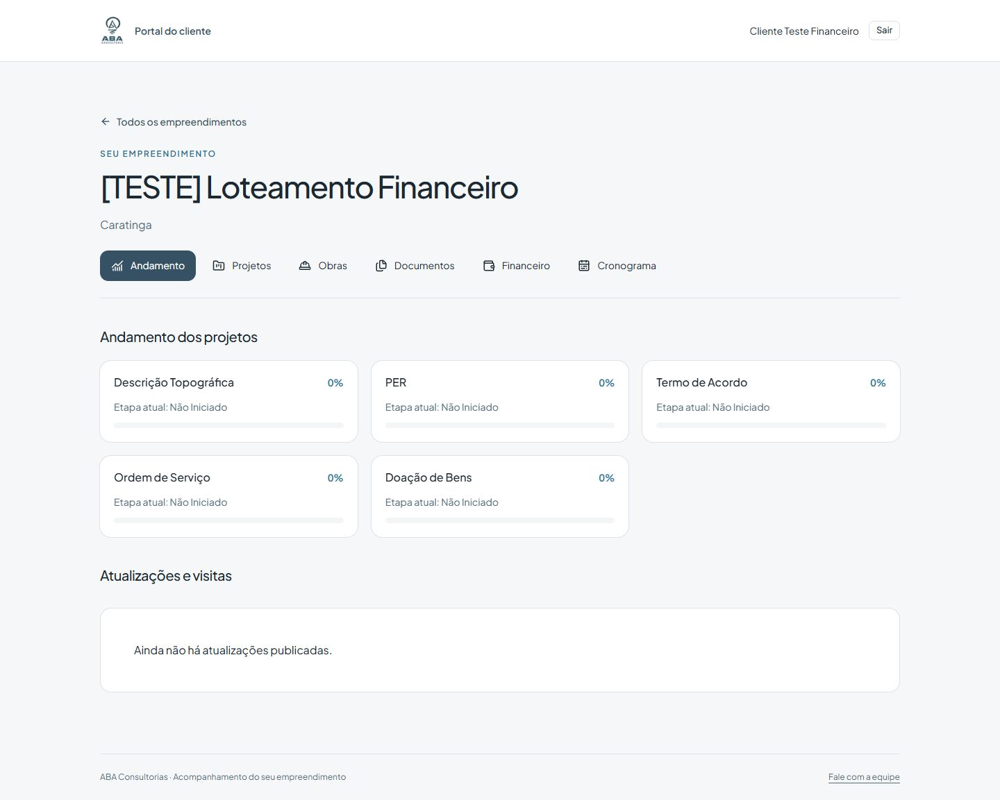 |
| 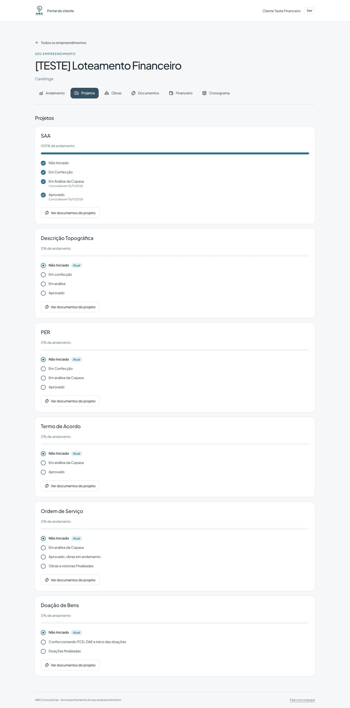 | 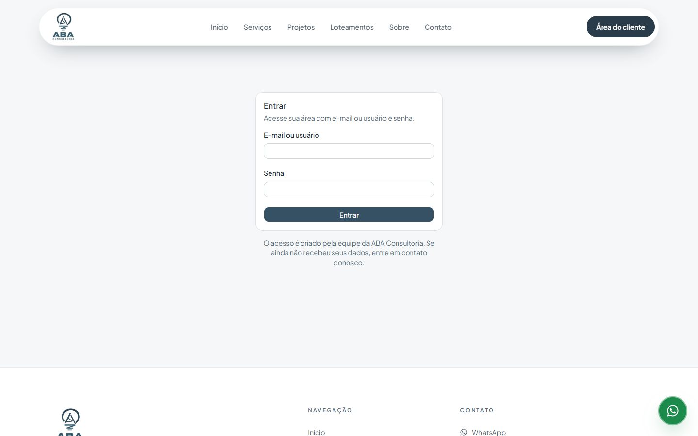 |

| Mobile | | |
|---|---|---|
| 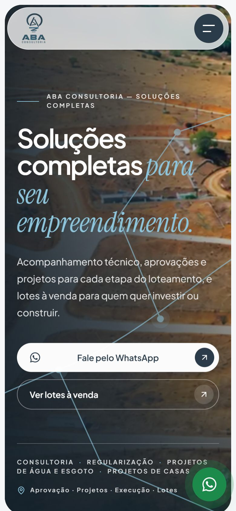 |  | 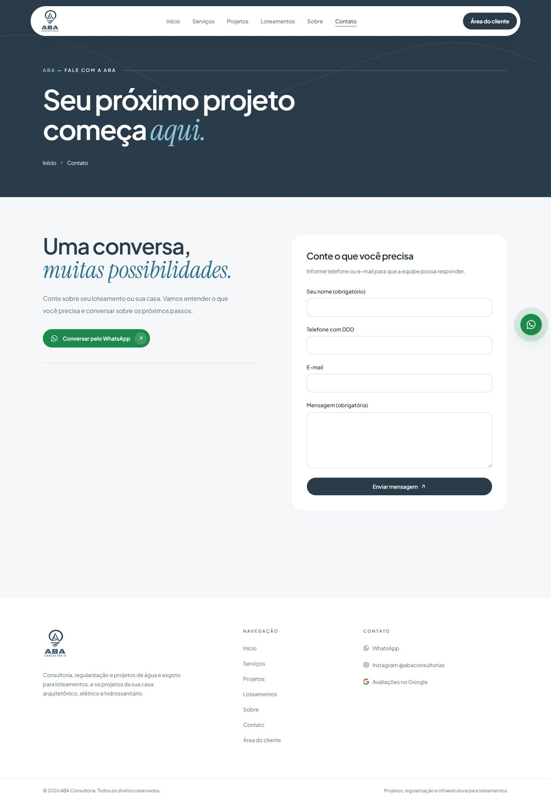 |

Página inicial completa: [docs/screenshots/home-completa.jpg](docs/screenshots/home-completa.jpg) ·
Projetos: [docs/screenshots/projetos.jpg](docs/screenshots/projetos.jpg)

## Destaques técnicos

**Arquitetura**
- Um único app **Next.js 16 (App Router)**: páginas, API Routes e tarefas agendadas no mesmo deploy na Vercel, com
  funções na mesma região do banco (`iad1` ↔ Supabase `us-east-1`).
- A API é organizada em módulos `route.ts` → `schema.ts` (Zod) → `service.ts`, com erros HTTP tipados e respostas
  padronizadas ([docs/API-MODULES.md](docs/API-MODULES.md)).
- Server Components por padrão. Client Components só onde há interação ([docs/WEB-OVERVIEW.md](docs/WEB-OVERVIEW.md)).

**Segurança**
- **Row Level Security em todas as tabelas**, com **34 suítes de teste SQL** (`supabase/tests/`) que tentam ler e
  escrever como cada papel (anônimo, cliente, empreiteiro, fornecedor, equipe com e sem permissão) e falham se algo
  vazar.
- **Permissões granulares** para a equipe interna (catálogo de permissões por área e ação), aplicadas no banco e na API.
- O painel administrativo fica num **caminho secreto** e responde 404 a quem não tem acesso. Não existe cadastro público.
- Senhas temporárias com troca obrigatória no primeiro acesso, IDs UUID, **rate limit** por IP com hash salgado e
  limites mais duros no login.
- **Content Security Policy**, sanitização de SVG e HTML enviados pelo painel (DOMPurify) e URLs assinadas de curta
  duração para baixar documentos.

**Documentos e automação**
- PDFs guardados no **Cloudflare R2** (API S3 assinada com `aws4fetch`) e exibidos no navegador com `pdf.js`.
- **Conector Windows** (`conector/`, Node 22 sem dependências): roda como tarefa agendada no servidor do escritório,
  varre a árvore de pastas, espera o arquivo estabilizar, calcula o hash e envia só o que é novo, em duas fases
  (reservar → enviar → confirmar) e de forma idempotente. A conta dele é dedicada e só tem leitura, e a chave fica
  cifrada com DPAPI.
- **Regras de montagem de pastas**: o painel reconhece a estrutura padrão de cada empreendimento e sugere em quais
  projetos e etapas cada pasta entra.
- **Etapas automáticas**: o andamento dos projetos avança sozinho quando chegam documentos com sinais no nome
  (protocolo, devolutiva, aprovado).
- **Financeiro** com itens e parcelas por marco do projeto, e um cronograma de pagamentos visível ao cliente.
- **Tarefa agendada** (Vercel Cron) que limpa arquivos órfãos no armazenamento, e **backup diário** do banco com
  espelho dos PDFs (`scripts/backup.mjs`).

**Testes**
- 34 suítes de RLS em SQL, cerca de 30 scripts de teste de integração HTTP e de regra de negócio em `scripts/`
  (permissões, portal, conector, montagem de pastas, CSP, sanitização) e testes unitários do conector com `node --test`.

## Stack

| Camada | Tecnologia |
|---|---|
| Framework | Next.js 16 (App Router), React 19, TypeScript |
| UI | Tailwind CSS v4, shadcn/ui (Radix), Motion, Lucide |
| Formulários e validação | React Hook Form + Zod |
| Banco e autenticação | Supabase (PostgreSQL, Auth, RLS, funções SQL) |
| Arquivos | Cloudflare R2 + pdf.js |
| E-mail | Resend |
| Hospedagem | Vercel (Functions + Cron) |
| Conector | Node.js 22 + PowerShell (Agendador de Tarefas do Windows) |

## Arquitetura

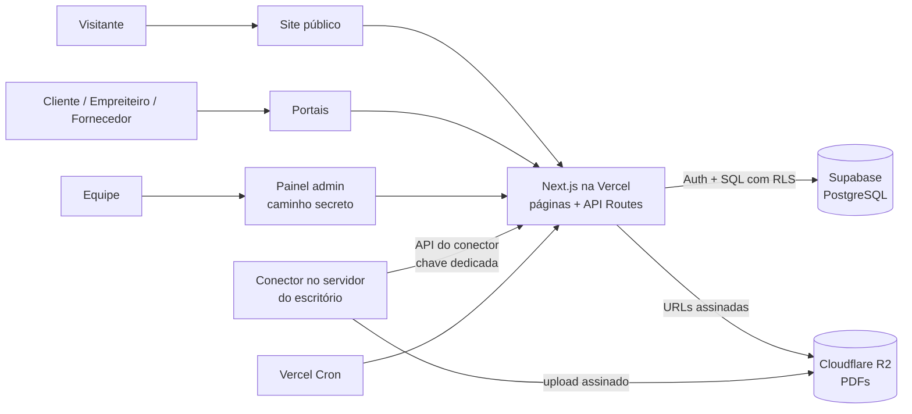

## Estrutura

```
src/
├── app/
│   ├── (public)/          site institucional (home, serviços, projetos, loteamentos, sobre, contato, entrar)
│   ├── cliente/           portal do cliente
│   ├── empreiteiro/       portal do empreiteiro
│   ├── fornecedor/        portal do fornecedor
│   ├── adm-interno/       painel da equipe (servido só pelo caminho secreto)
│   └── api/(modules)/     módulos de API (route + schema + service)
├── components/            publico/, portal/, admin/, auth/, ui/
└── lib/                   auth, supabase, portal, conector, rate limit
supabase/
├── migrations/            SQL versionado do banco (tabelas, RLS, funções)
├── tests/                 testes de RLS em SQL
└── reversoes/             scripts de reversão de cada migration
conector/                  programa que sincroniza o servidor de arquivos com o portal
scripts/                   seeds, backup e testes de integração
docs/                      documentação técnica (API, banco, segurança, front-end)
```

## Como rodar

1. Crie um projeto no Supabase e aplique as migrations de `supabase/migrations/` em ordem.
2. Copie `.env.example` para `.env` e preencha (cada variável está explicada no arquivo).
3. Instale e rode:
   ```bash
   npm install
   npm run dev
   ```
4. Crie a primeira conta da equipe com `node --env-file=.env scripts/criar-admin.mjs` e popule o conteúdo de exemplo
   com `scripts/semear-conteudo.mjs`.

Leia [docs/SECURITY.md](docs/SECURITY.md) antes de mexer no banco: toda tabela nova precisa de RLS e de testes.

## Documentação técnica

- [API: visão geral](docs/API-OVERVIEW.md) · [módulos](docs/API-MODULES.md) · [validação](docs/API-VALIDATION.md)
- [Banco de dados e RLS](docs/DATABASE.md) · [Segurança](docs/SECURITY.md)
- [Front-end](docs/WEB-OVERVIEW.md) · [camada de dados](docs/WEB-DATA-LAYER.md) · [componentes](docs/WEB-COMPONENTS.md)

## Direitos

Código publicado apenas para fins de portfólio. **Todos os direitos reservados.** A marca, os textos e as imagens
pertencem à ABA Consultorias e não podem ser reutilizados.
